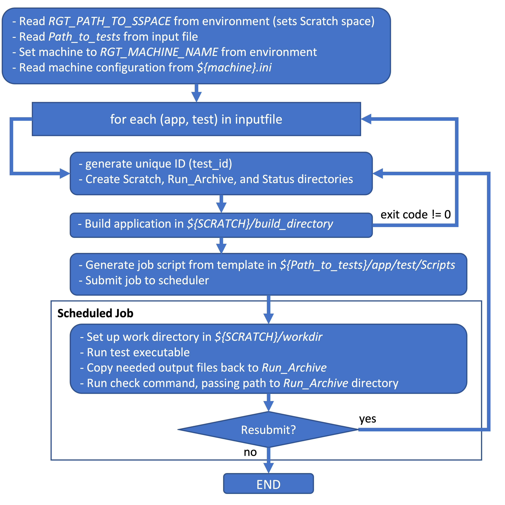

.. _section_overview:

============================
Overview of the Test Harness
============================

Purpose
=================

.. toctree::
   :maxdepth: 1

The OLCF Test Harness (OTH) is a light-weight templating framework that helps
automate the testing of applications, tools, and other system software. Users
of the OTH have the flexibility to run individual standalone tests or to
simulate production workloads by running a large collection of tests continuously.
Each test provides scripts that support the core operations of building
executables, running jobs, and checking test results.

Execution Overview
=====================

**othctl run** is the command used to execute the OTH. Users provide an
input file that lists the set of tests to run, and a command-line option
controls whether to run a single iteration (**\-\-mode start stop**)
or continuously (**\-\-mode start**). In continuous mode, the test job script has the
option to resubmit another iteration of the test.

A brief logical flow of harness execution follows:

....

